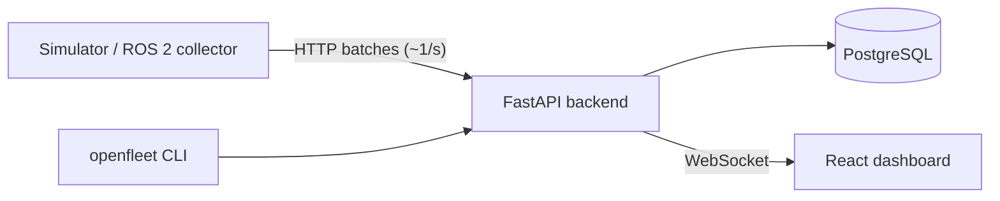

# OpenFleet Replay

**Observability, incident debugging, and replay for ROS 2 robot fleets.**

When a robot fails in production, engineers need to answer these questions:
- What happened?
- Which node or topic failed first?
- What changed in the seconds before?
- Which software version was running?
- Does the next version fix it or break something else?

OpenFleet Replay collects robot telemetry and tracks the health of ROS topics and nodes. It detects failures and opens deduplicated incidents, each with a timeline of what led up to it. You can **replay** a recorded run on the same dashboard used for live data, or **compare** two runs across software versions, either in the UI or as a CI gate.

## What it does

- **Fleet health:** robots register and heartbeat. OpenFleet derives ONLINE / OFFLINE / DEGRADED / ERROR from liveness (server time) and open incidents.
- **Topic and node monitoring:** expected vs. actual Hz per topic (`/scan` 15 Hz → 4 Hz → 0 Hz), plus node state.
- **Failure detection:** pure, unit-tested rules: heartbeat missing during a run, topic rate, node health, CPU, memory, battery.
- **Incidents:**
  - Opened automatically and deduplicated by a database constraint.
  - Escalated in place (WARNING → CRITICAL).
  - Auto-resolved with hysteresis. Never auto-resolved while the robot is offline.
  - Each has a timeline showing what happened first.
- **Runs:** every operating session is recorded with its software version. Starting and ending runs is idempotent (client-generated IDs).
- **Replay:** scrub through a past run at 1×–16×. The frontend feeds replay frames into the *same reducer* as the live WebSocket, so there's one UI, not two.
- **Re-detection replay:** run the *current* rules (or thresholds you're trying out) over a recorded run and see which recorded failures they'd still catch, which they'd miss, which are new, and when each would have fired. On the run page, or `openfleet redetect RUN [--set cpu_high_pct=80]`.
- **Compare and check:**
  - Diff two runs in the UI.
  - Or gate CI with `openfleet check RUN --config regression.yaml [--baseline RUN]`, which exits 1 on regression.
- **ROS 2 collector:** runs on the robot.
  - Measures every configured topic's real rate (raw, best-effort subscriptions, with message types auto-discovered).
  - Watches nodes in the ROS graph, forwards `/rosout` warnings, and reports battery, CPU and memory.
  - Optionally reads `/diagnostics`: each hardware status becomes a node OpenFleet can judge.
  - Keeps buffering through network outages without losing data.
  - Tested end to end on ROS 2 Jazzy in CI.
- **Simulator:** no robot required. Seeded YAML scenarios script failures, so every demo is reproducible.

## Quick start

Requires Docker.

```bash
git clone https://github.com/saiken13/openfleet-replay.git
cd openfleet-replay
docker compose --profile demo up --build
```

- **Dashboard:** http://localhost:8080
- **API docs:** http://localhost:8000/docs

The `demo` profile runs four simulated robots in a loop:
- **amr-02:** its LiDAR degrades and then stops, and its driver crashes.
- **amr-03:** CPU spikes.
- **amr-04:** drops off the network mid-run.
- **amr-01:** stays healthy as the control.

Open the dashboard, click an incident, then **Replay from 15s before ▶**.

Without `--profile demo` you get the platform with an empty fleet. Run the simulator yourself (see below).

Sign in as **operator / operator-demo** (can triage incidents) or **viewer / viewer-demo** (read-only). The login page shows these too.

The local stack seeds **public** demo credentials so it works with no setup: users and a viewer API token from `examples/demo-users.json`, and robot keys from `examples/demo-robot-keys.json`. Never expose that configuration (see [Authentication](#authentication)).

Postgres is published on host port **5433** (not 5432), so it doesn't clash with a locally installed Postgres. Override it with `OPENFLEET_PG_HOST_PORT`. Redis (realtime fan-out between replicas) is on host port **6380** (`OPENFLEET_REDIS_HOST_PORT`).

To run two backend replicas behind a round-robin nginx: `docker compose --profile replicas up -d --build --wait` (replicas on :8000 and :8001, load balancer on :8090), then `python scripts/multi_replica_e2e.py` to check that live updates reach every replica. CI runs the same check.

## Authentication

There are two kinds of credentials:
- **Robots** use a per-robot API key on their writes (register, heartbeat, runs, telemetry). A key only works for its own robot.
- **People** sign in to the dashboard. Every read and live view needs a user. Roles:
  - **viewer:** reads everything.
  - **operator:** can also triage incidents. Every triage action is recorded with who did it, on the **Audit** page.
- **CLI and CI** (`openfleet check`) use a user API token.

Manage everything on the server:

```bash
docker compose exec backend openfleet keys create ros-bot-01 --label "lab TurtleBot"   # robot key, printed once
docker compose exec backend openfleet keys list | revoke KEY_ID
docker compose exec backend openfleet users create alice --role operator             # prompts for a password
docker compose exec backend openfleet users list | set-role alice viewer | passwd alice | disable alice
docker compose exec backend openfleet users token create ci-bot --label ci --expires-days 90   # → OPENFLEET_TOKEN
docker compose exec backend openfleet retention --days 30 --dry-run   # what data retention would remove
```

- **Data retention:** off by default. Set `OPENFLEET_RETENTION_DAYS=30` and the backend compacts finished runs older than that: their summary is frozen (so `openfleet check` against an old baseline still works), and the per-second telemetry and log lines are deleted. Incidents and the triage audit are kept. See DECISIONS #030.
- **Rotating a robot key:** create a new one, deploy it, then revoke the old one. A robot can hold several active keys.
- **Sessions:** HttpOnly SameSite=Strict cookies. A session ends after 12 h without use, and always 7 days after sign-in (`OPENFLEET_SESSION_TTL_S` / `OPENFLEET_SESSION_MAX_S`).
- **Login throttling:** 5 failed sign-ins per username, or 20 per client IP, in 5 minutes gets a 429 with `Retry-After`. Tune it with `OPENFLEET_LOGIN_*`. Counters are shared across replicas through Redis.
- **Production:** behind HTTPS, set `OPENFLEET_COOKIE_SECURE=true`. Drop the demo `*_FILE` and `LOGIN_HINT` settings. Don't expose the backend port directly, and set `FORWARDED_ALLOW_IPS` to your proxy's address. The proxy must overwrite `X-Forwarded-For` (see `frontend/nginx.conf`).

See [DECISIONS #021, #022, #027 and #029](docs/DECISIONS.md).

## Embedded & C++

A C++20 edge agent, a binary device protocol and FreeRTOS firmware on an emulated STM32F4, all without physical hardware; see the [roadmap](docs/EMBEDDED_ROADMAP.md).

- **Phase 0 (done):** the dev container (`scripts/edge-dev.sh`), CMake presets with sanitizers and an aarch64 cross-compile tested under QEMU in CI, and a Renode STM32F4 smoke test (`firmware/renode/smoke.sh`).
- **Phase 1 (done):** `openfleet-edge-agent`, a C++20 agent for Linux robot computers without ROS. It reports CPU, memory, link latency, watched processes and its own health as robot `edge-01`. It buffers through outages with the collector's delivery contract, and ends its run on SIGTERM. Try it: `docker compose --profile edge up -d --build`, then `python edge/e2e/e2e.py`.
- **Phase 2 (done):** the [device protocol](docs/PROTOCOL.md): COBS + CRC-16 frames from a C11 library shared with the future firmware. The agent's gateway turns a microcontroller's sensors into topics, its tasks into nodes, and its resets into events. A simulated MCU with fault injection (`openfleet-device-sim`), two libFuzzer targets, and `python edge/e2e/device_e2e.py`.
- **Phase 3 (done):** [FreeRTOS firmware](docs/FIRMWARE.md) for an STM32F407, run on Renode's emulated STM32F4 (no board). It has sensor, comms, health and watchdog tasks. A stalled task causes a watchdog reset, which OpenFleet shows with its cause and as an incident that resolves. Try it: `docker compose --profile edge --profile firmware up -d --build`, then `python firmware/tests/firmware_e2e.py`.
- **Phase 4 (done):** a [regression tier and benchmarks](docs/BENCHMARKS.md). YAML scenarios inject faults into the compose stack and measure how long OpenFleet takes to show them (`python edge/e2e/run_scenarios.py`). A Robot Framework suite runs the firmware on Renode in emulated time, and micro-benchmarks cover the protocol and gateway. A nightly workflow puts it all in one report, with every figure labelled native, qemu-user or Renode.

See [edge/README.md](edge/README.md).

## Connect a real ROS 2 robot

On the robot, inside its ROS 2 environment (Humble or Jazzy):

```bash
source /opt/ros/jazzy/setup.bash
python3 -m venv --system-site-packages ~/openfleet && ~/openfleet/bin/pip install ./collector
cp collector/collector.example.yaml collector.yaml   # set api_url, robot_id, topics + expected Hz, nodes
export OPENFLEET_API_KEY=ofk_...                     # from `openfleet keys create <robot_id>`
~/openfleet/bin/openfleet-collector --config collector.yaml
```

It's also available as a Docker image (`collector/Dockerfile`, based on `ros:jazzy-ros-base`). To watch it work against a fake robot (a real ROS 2 node publishing `/scan`), run:

```bash
python collector/ros_test/e2e.py   # scripts a degradation, a stop, a node crash and a backend outage, and asserts each
```

## Regression gate in CI

```bash
pip install -e backend -e simulator
export OPENFLEET_ROBOT_KEYS_FILE=examples/demo-robot-keys.json                   # robot keys
export OPENFLEET_TOKEN=ofu_demo_viewer_public-not-secret                         # read token
openfleet-sim -s simulator/scenarios/healthy.yaml --fast -o base.json            # v1.0.0
openfleet-sim -s simulator/scenarios/lidar_regression.yaml --fast -o cand.json   # v1.1.0
openfleet check "$(jq -r '.[0].run_id' cand.json)" -c examples/regression.yaml \
  --baseline "$(jq -r '.[0].run_id' base.json)"
```

```
Run c9b8e261-…  robot=ci-01  version=1.1.0
  [FAIL] topic /scan avg_hz                  7.63 (limit >= 10)
  [FAIL] baseline topic /scan avg_hz drop %  14.92 → 7.63 Hz (+48.8% drop, limit 10%)
  …
12/14 checks passed                                        (exit code 1)
```

This exact flow runs in this repo's CI (`e2e-regression-check`). The healthy run must pass and the regression must fail.

To check a rule or threshold change against recorded failures instead, use `openfleet redetect RUN --fail-on-missed [--set NAME=VALUE ...]`: it exits 1 if a failure recorded in that run would no longer be detected. CI runs this as a gate on the regression run, and also checks that the gate fails when a looser threshold stops catching the LiDAR drop.

> Replay never re-runs robot software: a recording always gives the same result. To regression-test a new build, produce a **new run** with it (simulator or ROS 2 sim in CI), then `check` it against a baseline. See [ARCHITECTURE §7](docs/ARCHITECTURE.md).

## Architecture



A single backend process (a modular monolith) contains:
- the API
- services
- a pure-function detection engine
- an incident reconciler
- a liveness sweeper
- a realtime hub (in-process; with Redis pub/sub between replicas, so you can run several backends)

Details: [docs/ARCHITECTURE.md](docs/ARCHITECTURE.md) · Why it's built this way: [docs/DECISIONS.md](docs/DECISIONS.md) · Request flows: [docs/FLOW.md](docs/FLOW.md)

## Development

```bash
docker compose up -d postgres

# Backend (Python 3.12)
cd backend
python3.12 -m venv .venv && .venv/bin/pip install -e ".[dev]"
.venv/bin/alembic upgrade head
.venv/bin/pytest                         # real Postgres, separate `openfleet_test` DB (auto-created)
OPENFLEET_ROBOT_KEYS_FILE=../examples/demo-robot-keys.json OPENFLEET_USERS_FILE=../examples/demo-users.json \
  .venv/bin/uvicorn app.main:app --reload  # http://localhost:8000 (seeds demo robot keys and users)

# Simulator
cd simulator
python3.12 -m venv .venv && .venv/bin/pip install -e ".[dev]"
export OPENFLEET_ROBOT_KEYS_FILE=../examples/demo-robot-keys.json
.venv/bin/openfleet-sim -s scenarios/demo.yaml            # real time
.venv/bin/openfleet-sim -s scenarios/demo.yaml --speed 4  # compressed
# Other scenarios: healthy, lidar_regression, telemetry_stall (data stops, heartbeats continue)
.venv/bin/pytest

# Frontend (Node 22+) — from the repo root (or `cd frontend` and use the same commands)
npm install        # installs frontend/ dependencies
npm run dev        # http://localhost:5173, proxies /api to localhost:8000 (backend must be running)
npm test && npm run typecheck
```

## Repository layout

| Path | Contents |
|---|---|
| `backend/app/` | FastAPI app: `api/` (routers), `services/`, `repositories/` (SQL), `detection/` (pure rules), `realtime/` (hub), `workers/` (sweeper) |
| `backend/openfleet_cli/` | `openfleet check` regression CLI (thin HTTP client), `openfleet keys` and `openfleet users` (credentials, direct DB) |
| `backend/alembic/` | Migrations (CI runs `alembic check` so models and migrations can't drift) |
| `collector/` | ROS 2 collector (runs on the robot) + ROS 2 end-to-end test |
| `simulator/` | Simulated robots + YAML failure scenarios (public API only) |
| `frontend/` | React + TypeScript + Vite + Tailwind dashboard |
| `examples/` | Example regression config; public demo robot keys and users |
| `docs/` | Architecture, decisions, flows, constraints, bugs |

## Status and limits

This is an MVP. It's single-process by design. The known scaling limits and their evolution paths are listed in [ARCHITECTURE §10](docs/ARCHITECTURE.md). These aren't built yet:
- SSO/OIDC and multi-tenancy (built-in users, roles and robot keys are done)
- rosbag/MCAP recordings

## License

[Apache-2.0](LICENSE)
