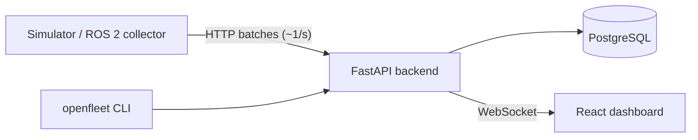

# OpenFleet Replay

**Observability, incident debugging, and replay for ROS 2 robot fleets.**

When a robot fails in production, engineers need to answer these questions:
- What happened?
- Which node or topic failed first?
- What changed in the seconds before?
- Which software version was running?
- Does the next version fix it or break something else?

OpenFleet Replay collects robot telemetry and tracks the health of ROS topics and nodes. It detects failures and opens deduplicated incidents, each with a timeline of what led up to it. You can **replay** a recorded run on the same dashboard used for live data, or **compare** two runs across software versions, either in the UI or as a CI gate.

## What it does

- **Fleet health:** robots register and heartbeat. OpenFleet derives ONLINE / OFFLINE / DEGRADED / ERROR from liveness (server time) and open incidents.
- **Topic and node monitoring:** expected vs. actual Hz per topic (`/scan` 15 Hz → 4 Hz → 0 Hz), plus node state.
- **Failure detection:** pure, unit-tested rules: heartbeat missing during a run, topic rate, node health, CPU, memory, battery.
- **Incidents:**
  - Opened automatically and deduplicated by a database constraint.
  - Escalated in place (WARNING → CRITICAL).
  - Auto-resolved with hysteresis. Never auto-resolved while the robot is offline.
  - Each has a timeline showing what happened first.
- **Runs:** every operating session is recorded with its software version. Starting and ending runs is idempotent (client-generated IDs).
- **Replay:** scrub through a past run at 1×–16×. The frontend feeds replay frames into the *same reducer* as the live WebSocket, so there's one UI, not two.
- **Compare and check:**
  - Diff two runs in the UI.
  - Or gate CI with `openfleet check RUN --config regression.yaml [--baseline RUN]`, which exits 1 on regression.
- **ROS 2 collector:** runs on the robot.
  - Measures every configured topic's real rate (raw, best-effort subscriptions, with message types auto-discovered).
  - Watches nodes in the ROS graph, forwards `/rosout` warnings, and reports battery, CPU and memory.
  - Keeps buffering through network outages without losing data.
  - Tested end to end on ROS 2 Jazzy in CI.
- **Simulator:** no robot required. Seeded YAML scenarios script failures, so every demo is reproducible.

## Quick start

Requires Docker.

```bash
git clone https://github.com/saiken13/openfleet-replay.git
cd openfleet-replay
docker compose --profile demo up --build
```

- **Dashboard:** http://localhost:8080
- **API docs:** http://localhost:8000/docs

The `demo` profile runs four simulated robots in a loop:
- **amr-02:** its LiDAR degrades and then stops, and its driver crashes.
- **amr-03:** CPU spikes.
- **amr-04:** drops off the network mid-run.
- **amr-01:** stays healthy as the control.

Open the dashboard, click an incident, then **Replay from 15s before ▶**.

Without `--profile demo` you get the platform with an empty fleet. Run the simulator yourself (see below).

Robots authenticate with per-robot API keys (see below). The local stack seeds the **public** demo keys in `examples/demo-robot-keys.json`, so the demo works with no setup. Never expose that configuration.

Postgres is published on host port **5433** (not 5432), so it doesn't clash with a locally installed Postgres. Override it with `OPENFLEET_PG_HOST_PORT`.

## Robot API keys

Every robot write (register, heartbeat, runs, telemetry) needs `Authorization: Bearer <key>`, and a key only works for its own robot. Reads are still open (dashboard auth is next). Manage keys on the server:

```bash
docker compose exec backend openfleet keys create ros-bot-01 --label "lab TurtleBot"   # prints the key once
docker compose exec backend openfleet keys list [--robot ros-bot-01]
docker compose exec backend openfleet keys revoke KEY_ID
```

To rotate a key, create a new one, deploy it, then revoke the old one. A robot can hold several active keys. See [DECISIONS #021](docs/DECISIONS.md).

## Connect a real ROS 2 robot

On the robot, inside its ROS 2 environment (Humble or Jazzy):

```bash
source /opt/ros/jazzy/setup.bash
python3 -m venv --system-site-packages ~/openfleet && ~/openfleet/bin/pip install ./collector
cp collector/collector.example.yaml collector.yaml   # set api_url, robot_id, topics + expected Hz, nodes
export OPENFLEET_API_KEY=ofk_...                     # from `openfleet keys create <robot_id>`
~/openfleet/bin/openfleet-collector --config collector.yaml
```

It's also available as a Docker image (`collector/Dockerfile`, based on `ros:jazzy-ros-base`). To watch it work against a fake robot (a real ROS 2 node publishing `/scan`), run:

```bash
python collector/ros_test/e2e.py   # scripts a degradation, a stop, a node crash and a backend outage, and asserts each
```

## Regression gate in CI

```bash
pip install -e backend -e simulator
export OPENFLEET_ROBOT_KEYS_FILE=examples/demo-robot-keys.json                   # robot keys
openfleet-sim -s simulator/scenarios/healthy.yaml --fast -o base.json            # v1.0.0
openfleet-sim -s simulator/scenarios/lidar_regression.yaml --fast -o cand.json   # v1.1.0
openfleet check "$(jq -r '.[0].run_id' cand.json)" -c examples/regression.yaml \
  --baseline "$(jq -r '.[0].run_id' base.json)"
```

```
Run c9b8e261-…  robot=ci-01  version=1.1.0
  [FAIL] topic /scan avg_hz                  7.63 (limit >= 10)
  [FAIL] baseline topic /scan avg_hz drop %  14.92 → 7.63 Hz (+48.8% drop, limit 10%)
  …
12/14 checks passed                                        (exit code 1)
```

This exact flow runs in this repo's CI (`e2e-regression-check`). The healthy run must pass and the regression must fail.

> Replay never re-runs robot software: a recording always gives the same result. To regression-test a new build, produce a **new run** with it (simulator or ROS 2 sim in CI), then `check` it against a baseline. See [ARCHITECTURE §7](docs/ARCHITECTURE.md).

## Architecture



A single backend process (a modular monolith) contains:
- the API
- services
- a pure-function detection engine
- an incident reconciler
- a liveness sweeper
- an in-process realtime hub

Details: [docs/ARCHITECTURE.md](docs/ARCHITECTURE.md) · Why it's built this way: [docs/DECISIONS.md](docs/DECISIONS.md) · Request flows: [docs/FLOW.md](docs/FLOW.md)

## Development

```bash
docker compose up -d postgres

# Backend (Python 3.12)
cd backend
python3.12 -m venv .venv && .venv/bin/pip install -e ".[dev]"
.venv/bin/alembic upgrade head
.venv/bin/pytest                         # real Postgres, separate `openfleet_test` DB (auto-created)
OPENFLEET_ROBOT_KEYS_FILE=../examples/demo-robot-keys.json \
  .venv/bin/uvicorn app.main:app --reload  # http://localhost:8000 (seeds the demo robot keys)

# Simulator
cd simulator
python3.12 -m venv .venv && .venv/bin/pip install -e ".[dev]"
export OPENFLEET_ROBOT_KEYS_FILE=../examples/demo-robot-keys.json
.venv/bin/openfleet-sim -s scenarios/demo.yaml            # real time
.venv/bin/openfleet-sim -s scenarios/demo.yaml --speed 4  # compressed
.venv/bin/pytest

# Frontend (Node 22+) — from the repo root (or `cd frontend` and use the same commands)
npm install        # installs frontend/ dependencies
npm run dev        # http://localhost:5173, proxies /api to localhost:8000 (backend must be running)
npm test && npm run typecheck
```

## Repository layout

| Path | Contents |
|---|---|
| `backend/app/` | FastAPI app: `api/` (routers), `services/`, `repositories/` (SQL), `detection/` (pure rules), `realtime/` (hub), `workers/` (sweeper) |
| `backend/openfleet_cli/` | `openfleet check` regression CLI (thin HTTP client) and `openfleet keys` (robot API keys, direct DB) |
| `backend/alembic/` | Migrations (CI runs `alembic check` so models and migrations can't drift) |
| `collector/` | ROS 2 collector (runs on the robot) + ROS 2 end-to-end test |
| `simulator/` | Simulated robots + YAML failure scenarios (public API only) |
| `frontend/` | React + TypeScript + Vite + Tailwind dashboard |
| `examples/` | Example regression config; public demo robot keys |
| `docs/` | Architecture, decisions, flows, constraints, bugs |

## Status and limits

This is an MVP. It's single-process by design. The known scaling limits and their evolution paths are listed in [ARCHITECTURE §10](docs/ARCHITECTURE.md). These aren't built yet:
- dashboard/user authentication, roles and WebSocket auth (robot API keys are done)
- re-detection replay
- rosbag/MCAP recordings

## License

[Apache-2.0](LICENSE)
