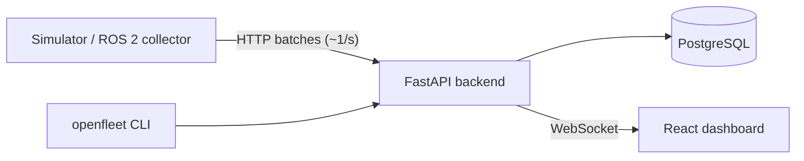

# OpenFleet Replay

**Observability, incident debugging, and replay for ROS 2 robot fleets.**

> ⚠️ **Status: early development (Phase 1).** The backend runs with a health check, the robots/runs schema, and robot registration (`PUT /api/v1/robots/{id}`). Features below are the MVP target. See [HANDOFF.md](HANDOFF.md) for current progress.

When a robot fails in production, engineers need to answer: *What happened? Which node or topic failed first? What changed in the seconds before? Which software version was running? Does the next version fix it or break something else?*

OpenFleet Replay collects robot telemetry, tracks ROS topic and node health, detects failures, opens deduplicated incidents with a timeline of what led up to them, and lets you **replay** a recorded run or **compare** two runs across software versions.

## What it does (MVP scope)

- **Fleet health:** robots register and heartbeat, and OpenFleet derives ONLINE / OFFLINE / DEGRADED / ERROR.
- **Topic and node monitoring:** expected vs. actual Hz per topic (e.g. `/scan` 15 Hz → 4 Hz → 0 Hz), node state.
- **Failure detection:** modular rules (heartbeat missing, topic rate, node health, CPU, memory, battery).
- **Incidents:** opened automatically, deduplicated, escalated, and auto-resolved, each with a pre-failure timeline.
- **Runs:** every operating session is recorded with its software version.
- **Replay:** scrub through a past run at 1×/2×/4× on the same dashboard used for live data.
- **Compare and check:** diff two runs, or assert `/scan >= 10 Hz` and "no CRITICAL incidents" from a CLI that returns a non-zero exit code on failure.
- **Simulator:** no robot required. Scripted failure scenarios make every demo reproducible.

## Architecture



A single backend process (modular monolith) contains the API, services, a pure-function detection engine, an incident reconciler, a liveness sweeper, and an in-process realtime hub.
Details: [docs/ARCHITECTURE.md](docs/ARCHITECTURE.md) · Why it's built this way: [docs/DECISIONS.md](docs/DECISIONS.md)

## Quick start

Requires Docker.

```bash
git clone https://github.com/saiken13/openfleet-replay.git
cd openfleet-replay
docker compose up --build
curl http://localhost:8000/api/v1/health   # {"status":"ok","database":"ok"}
# API docs: http://localhost:8000/docs
```

Postgres is published on host port **5433** (not 5432) so it doesn't clash with a locally installed Postgres. Override it with `OPENFLEET_PG_HOST_PORT`.

### Backend development (without running the backend in Docker)

```bash
docker compose up -d postgres
cd backend
python3.12 -m venv .venv && .venv/bin/pip install -e ".[dev]"
.venv/bin/alembic upgrade head
.venv/bin/pytest            # real Postgres, in a separate `openfleet_test` DB (created automatically)
.venv/bin/uvicorn app.main:app --reload
```

## Repository layout

| Path | Contents |
|---|---|
| `backend/` | FastAPI app, detection engine, replay, Alembic migrations, tests |
| `simulator/` | Simulated robots and failure scenarios (YAML) |
| `frontend/` | React + TypeScript + Vite dashboard |
| `docs/` | Architecture, decisions, flows, constraints, bugs, feature docs |

## Documentation

- [Architecture](docs/ARCHITECTURE.md): components, data model, detection, replay, scaling limits
- [Decisions](docs/DECISIONS.md): why we chose what we chose
- [Flows](docs/FLOW.md): how a request moves through the code
- [Constraints](docs/CONSTRAINTS.md): rules for contributors (human or AI)

## License

[Apache-2.0](LICENSE)
