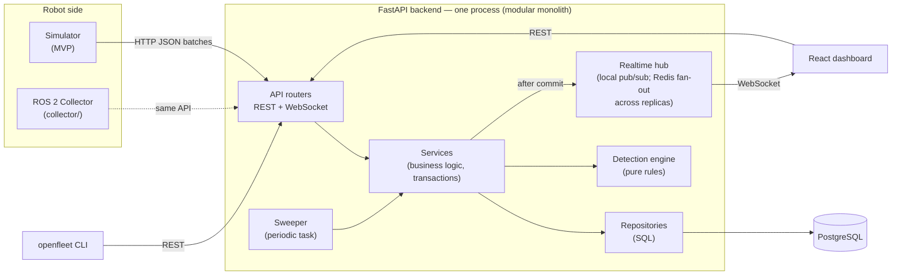

# Architecture

> **Status: Implemented (MVP).** Every section describes the code as it is. Where the build refined the original plan, the section says so and links the decision.
> Rule: if the code and this document disagree, one of them is a bug.

## 1. System overview



**The main idea:** the robot side *aggregates* and the server *judges*.
The collector or simulator measures things like "/scan is publishing at 4.1 Hz". It sends a summary about once per second instead of forwarding raw sensor messages.
The backend stores those summaries. It decides whether something is unhealthy and records what happened so the run can be replayed later.

## 2. Components

| Component | Responsibility | Must NOT |
|---|---|---|
| **Simulator** (`simulator/`) | Simulates N robots: registration, heartbeats, runs, metrics, topic rates, node states, logs. Runs scripted failure **scenarios** (YAML) with a seeded RNG so failures are reproducible. It is the reference client for the API. | Import backend code. It may only use the public HTTP API. |
| **ROS 2 collector** (`collector/`) | On the robot. Raw best-effort subscriptions count topic arrivals in a sliding window. Node liveness comes from the ROS graph, logs from `/rosout` (WARN+), battery from `BatteryState`, and CPU/memory from psutil. It POSTs the same `TelemetryBatch` as the simulator. Its uplink buffers through outages and self-heals runs (DECISIONS #020). | Deserialize messages or run inside the robot's own process. |
| **API routers** (`backend/app/api/`) | HTTP/WS boundary: parse and validate input with Pydantic, call a service, map domain errors to HTTP codes. | Contain business rules or SQL. |
| **Services** (`backend/app/services/`) | Use-case logic: "ingest a batch", "process a heartbeat", "open/resolve incidents". They own transaction boundaries and call the detection engine and realtime hub. | Know about HTTP. |
| **Repositories** (`backend/app/repositories/`) | All SQL for one aggregate (robots, runs, telemetry, events, incidents). Return ORM or domain objects. | Make business decisions. |
| **Detection engine** (`backend/app/detection/`) | Pure functions: `RobotSnapshot → list[Finding]`. Topic-health classification lives here too. | Touch the DB, the clock, or the network (the caller passes in `now`). |
| **Incident reconciler** (in `services/incident_service.py`) | Compares the current findings with open incidents and decides to open, escalate, or resolve. This is the stateful half of detection. | — |
| **Sweeper** (`backend/app/workers/`) | Runs every `sweep_interval_s`. It catches problems that only show up as *missing* data: missing heartbeats, stale topics, abandoned runs. | Run a tick on two replicas at once: each tick takes a Postgres advisory lock (DECISIONS #024). |
| **Realtime hub** (`backend/app/realtime/`) | Pub/sub: local delivery, plus Redis fan-out to other replicas when `REDIS_URL` is set (DECISIONS #025). Services publish *after commit*, and WebSocket connections subscribe. | Be the source of truth. If the browser reconnects, it reloads data over REST. |
| **Replay** (`backend/app/replay/`) | Builds a run's ordered, merged event stream (read-only). Later it will also re-run detection rules over a recorded run. | Hold server-side playback state. Pacing happens in the client. |
| **PostgreSQL** | Source of truth for identity, current state, time series, events, and incidents. Enforces idempotency and dedup with constraints. | Store large binary recordings. Those go to object storage in Phase 2+. |
| **Frontend** (`frontend/`) | React + TS + Vite SPA. A single reducer turns events into dashboard state, and both **live** (WS) and **replay** (stream + client clock) feed that same reducer. | Compute health or incident logic itself. |
| **CLI** (`backend/openfleet_cli/`, installed as `openfleet`) | `openfleet check <run> --config regression.yaml` returns a non-zero exit code when a check fails. A thin HTTP client. | Re-implement detection logic. |

## 3. Data model

Design principle: **separate kinds of data by how they're written and read**, rather than forcing everything into one generic table.

| Kind | Tables | Write pattern | Read pattern |
|---|---|---|---|
| Identity | `robots` (identity columns) | Rare (registration) | Everywhere |
| Current state | `robots` (state columns), `topic_states`, `node_states` | Upsert (overwrite), every batch | Dashboard "now" view, detection snapshot |
| Time series | `telemetry_samples`, `topic_samples` | Append, ~1/s per robot | Charts, compare, replay |
| Discrete events | `events` | Append, sparse (only on *change*) | Timeline, replay, logs |
| Lifecycle entities | `runs`, `incidents` | Create + status transitions | Lists, detail pages |
| Audit | `triage_actions` | Append-only, one row per manual status change | Audit page, per-incident history |

### Tables

Models: `backend/app/db/models.py`. Migrations: `0001` (robots, runs), `0002` (telemetry, events, incidents), `0003` (robot API keys), `0004` (users, tokens), `0005` (triage actions). Status-like columns are TEXT + CHECK (DECISIONS #015). Two columns were added beyond the original plan:
- `topic_samples.status`: classified at ingest, so summaries and replay don't re-classify.
- `incidents.last_detected_at`: drives the auto-resolve hysteresis.

**robots**: identity and current state live in one row, but different code paths write them.
- Identity: `id TEXT PK` (robot-chosen, immutable, e.g. `robot-01`), `name`, `model`, `created_at`
- State (written only by the heartbeat/ingest/sweeper services): `status` (ONLINE/OFFLINE/DEGRADED/ERROR), `software_version`, `last_seen_at` (**server** time), `current_run_id`, `battery_pct`, `cpu_pct`, `mem_pct`, `updated_at`
- `status` is **derived by OpenFleet** from liveness and open incidents. The robot never sets it directly.

**runs**: one operating session.
- At most one RUNNING run per robot: the latest-started one (DECISIONS #016).
- `id UUID PK` (**generated by the client**, which makes "start run" safe to retry), `robot_id FK`, `software_version`, `status` (RUNNING/SUCCESS/FAILED/ABORTED), `started_at`, `ended_at`
- Counts (telemetry/events/incidents) are **computed on read** in the MVP. We'll add stored counters only if a measured query turns out slow, because a counter row that every ingest updates becomes a write hotspot.
- Index: `(robot_id, started_at DESC)`

**telemetry_samples**: one row per ingested batch (~1 Hz).
- `id BIGSERIAL`, `run_id FK`, `robot_id FK` (denormalized), `seq INT`, `ts` (robot clock), `received_at` (server clock), `cpu_pct`, `mem_pct`, `battery_pct`, `net_latency_ms`, `pose_x`, `pose_y`, `pose_yaw`
- `UNIQUE (run_id, seq)`: **ingestion idempotency**. If a collector retries a batch, nothing gets duplicated.
- Index: `(run_id, ts)`

**topic_samples**: per-topic rate history (needed for compare and replay).
- `id BIGSERIAL`, `run_id`, `robot_id`, `seq`, `ts`, `topic`, `expected_hz`, `actual_hz`, `last_msg_age_s`
- `UNIQUE (run_id, seq, topic)`, index `(run_id, topic, ts)`

**topic_states / node_states**: current-state projections. They hold "now" so neither the dashboard nor detection has to scan history.
- `topic_states`: PK `(robot_id, topic)`, `expected_hz`, `actual_hz`, `status` (HEALTHY/DEGRADED/FAILED/UNKNOWN), `status_since`, `last_msg_at`, `updated_at`
- `node_states`: PK `(robot_id, node)`, `state` (RUNNING/DEGRADED/STOPPED/ERROR), `state_since`, `last_seen_at`, `started_at`, `stopped_at`
- Node *history* is not sampled. Each node state change becomes an `events` row.

**events**: a normalized stream of discrete things that *happened*.
- `id BIGSERIAL`, `robot_id`, `run_id NULL`, `ts`, `received_at`, `type`, `severity` (INFO/WARNING/ERROR), `source` (node/topic name or `openfleet`), `message`, `payload JSONB`
- Types: `run_started`, `run_ended`, `topic_status_changed`, `node_state_changed`, `log`, `robot_status_changed`, `software_version_changed`, `incident_opened`, `incident_escalated`, `incident_resolved`
- Rows are written on **change**, not on every sample: "/scan went HEALTHY→DEGRADED" is an event, while "/scan is still 15 Hz" is not.
- Logs: by default the collector forwards WARN and above. INFO forwarding is configurable to limit volume.
- Indexes: `(run_id, ts)`, `(robot_id, ts)`

**incidents**
- `id UUID PK`, `robot_id`, `run_id NULL`, `rule`, `dedup_key` (e.g. `topic_rate:/scan`), `severity` (INFO/WARNING/CRITICAL), `status` (OPEN/INVESTIGATING/RESOLVED), `title`, `description`, `software_version`, `evidence JSONB` (the rule's snapshot when it fired), `started_at`, `resolved_at`, `created_at`, `updated_at`
- **Dedup:** `UNIQUE (robot_id, dedup_key) WHERE status <> 'RESOLVED'` (a partial unique index). It allows at most one *unresolved* incident per robot per failure, and the database enforces this even under concurrent writers.

**triage_actions** (migration `0005`, DECISIONS #026)
- `id BIGSERIAL` (also the paging order), `incident_id`, `robot_id`, `actor` (username), `from_status`, `to_status`, `at` (server time)
- One row per manual status change, written in the same transaction. NULL `actor`/`from_status` only on rows backfilled from older `incident_resolved` events.
- Kept apart from `events` so telemetry retention never removes who triaged what.

### Deliberately *not* tables
- **Heartbeats**: they update `robots.last_seen_at` and are not stored. Their history is noise, and anything meaningful about them (going OFFLINE, a version change) becomes an event.
- **Software versions**: version history comes from `runs` (`SELECT DISTINCT software_version … ORDER BY started_at`) plus `software_version_changed` events. We'll add a table when we have deployments or rollouts.
- **Incident timelines**: computed, not stored (see §5).

## 4. Time

- `ts` is **robot time**. It orders data *within a run*, which is consistent because one robot clock covers the whole run.
- `received_at` and `last_seen_at` are **server time**. All liveness and expiry logic uses server time, because robot clocks may be skewed or unsynchronized.
- Ordering *across* robots by `ts` is best-effort. This is a known limitation, documented rather than hidden.

## 5. Key flows (summary — see [FLOW.md](FLOW.md) for file-level detail)

**Ingest:** `POST /runs/{id}/telemetry` → validate → **one transaction** (DECISIONS #018), holding the robot row lock:
1. Insert the sample (`ON CONFLICT DO NOTHING` on seq).
2. Upsert current state and emit change events.
3. Bump `last_seen_at`.
4. Build the snapshot, run detection and reconcile incidents.
5. Derive the robot's status.
6. Commit, then publish to the hub.

**Liveness:** every `SWEEP_INTERVAL_S`, the sweeper (on whichever replica wins the tick's advisory lock, DECISIONS #024):
- Re-evaluates robots that are not OFFLINE but whose `last_seen_at < now - HEARTBEAT_TIMEOUT_S`. This derives OFFLINE, and HeartbeatMissingRule fires if they were in a run (DECISIONS #019).
- Aborts the current run of robots silent for longer than `RUN_ABANDON_AFTER_S`.

**Detection:** see §6.

**Incident timeline:** `events ∪ downsampled samples` for the robot over `[started_at - lookback_s, resolved_at or now]`, ordered by `ts`. Because it's a query, improving it later never requires migrating stored data.

**Replay:** see §7.

## 6. Detection engine

```python
class DetectionRule(Protocol):
    name: str
    def evaluate(self, snap: RobotSnapshot, now: datetime, cfg: DetectionConfig) -> list[Finding]: ...

@dataclass(frozen=True)
class Finding:
    rule: str
    dedup_key: str          # identifies "the same ongoing failure"
    severity: Severity
    title: str
    description: str
    evidence: dict
```

- Code: `backend/app/detection/` (`model.py`, `rules.py`, `topic_health.py`). Thresholds come from settings through `DetectionConfig`.
- MVP rules: `HeartbeatMissingRule` (only while in a run, #019), `TopicRateRule` (degraded → WARNING, failed → CRITICAL), `NodeHealthRule`, `HighCpuRule`, `HighMemoryRule`, `LowBatteryRule`. Each rule is a small class with its own thresholds, and a registry holds the list.
- **Rules are pure.** That makes them trivial to unit-test and, more importantly, lets the **same code run live, during re-detection replay, and in CI**.
- **Two triggers:** event-driven (after ingest, for that robot) and time-driven (sweeper, all robots). A "data stopped arriving" condition can't trigger on ingest, because no request arrives.
- **Snapshot** (`Detector.snapshot`): built from current-state tables only. It includes run data (topics, nodes, metrics) only while the robot is in a run and the rows are fresh (DECISIONS #017).
- **Reconciliation** (stateful, `backend/app/services/detection_service.py :: Detector.reconcile`):
  - a new `dedup_key` → open an incident (`INSERT … ON CONFLICT DO NOTHING` against the partial unique index)
  - an existing key at higher severity → escalate the same incident (no new incident)
  - a key that is no longer reported for `INCIDENT_RESOLVE_AFTER_S` → auto-resolve, **only while the robot is live** (hysteresis, so a flapping topic doesn't open and close incidents every second; #019)
  - the robot reports its run ended → that run's data incidents resolve with reason "run ended" (#017)
  - manual triage: OPEN → INVESTIGATING → RESOLVED via `PATCH /incidents/{id}`. RESOLVED is final, so a persisting condition opens a new incident. Each change is recorded with its operator in `triage_actions` (#026), listed by `GET /triage`.
- **Topic health** is a pure function: `classify(expected_hz, actual_hz, last_msg_age_s, thresholds) → HEALTHY | DEGRADED | FAILED`.
- Robot status is derived as: OFFLINE if not live; ERROR if a CRITICAL incident is open; DEGRADED if a WARNING incident is open; otherwise ONLINE.

## 7. Replay

- **Backend:** `GET /runs/{id}/stream` returns the run's samples, topic samples, and events merged into one list ordered by `(ts, kind, id)`, with cursor pagination. It's stateless and read-only.
- **Frontend:** `frontend/src/replay/ReplayClock.ts` (play/pause/restart/seek, 1×–16×, incident markers on the scrubber) pulls the stream and dispatches frames into the **same reducer** (`frontend/src/state/robotReducer.ts`) the live WebSocket feeds, and both render `RobotView`. The dashboard can't tell live data from replay data, so we don't build two UIs.
- Why the client paces the replay: the server keeps no per-viewer session state, seeking is trivial, and it scales like any read. A server-paced WS replay would need session lifecycle, backpressure, and cleanup, and the MVP doesn't need any of that.
- **Re-detection replay** (DECISIONS #023): `POST /runs/{id}/redetect` rebuilds the snapshot after each stored batch, runs the *current* rules (optionally with overridden thresholds), simulates the reconciler in robot time, and compares the result with the incidents recorded live: caught, missed, new, and how much earlier or later. It's pure (`app/detection/replay.py`) and read-only. The run page has a panel for it, and `openfleet redetect` is the CLI.

### What replay does *not* do (important)
Replaying a *recording* doesn't run new robot software, so a recorded run always gives the same result. (Re-detection replays only the *detection*: new rules or thresholds over the same recorded data.) Regression testing of a new software version works by **producing a new run** (CI starts the simulator or ROS 2 sim with the new build) and then running `openfleet check` on it and comparing it with a baseline run. Re-running *robot software* against recorded sensor data (rosbag2/MCAP playback) is a Phase 3 capability.

## 8. Realtime

- `WS /api/v1/ws/fleet`: `{"type": "robot"}` and `{"type": "incident"}` messages for every robot.
- `WS /api/v1/ws/robots/{robot_id}`: the same plus `{"type": "frame", "data": Frame}`. A frame (`sample` | `topic` | `event`) has exactly the shape of a replay stream item.
- Hub: `backend/app/realtime/hub.py`. Bounded per-subscriber queues; a slow client drops its oldest messages and never blocks ingest.
- Across replicas (DECISIONS #025): `backend/app/realtime/bus.py` forwards every locally published message over Redis pub/sub, and the other replicas deliver it to their subscribers. Messages carry a per-instance sequence number (plus a heartbeat). When a replica sees a gap, or has just (re)subscribed, it closes its WebSockets with **1012** and clients reload over REST.
- Services publish **after the transaction commits** (`Service.commit()` in `services/base.py` flushes an outbox), so the UI never shows data that could still roll back.
- WS messages are hints. On connect or reconnect the client loads current state over REST, then applies deltas.

## 9. Configuration

`pydantic-settings` with environment variables prefixed `OPENFLEET_` (`backend/app/core/config.py`). All timing and thresholds live here, never inline:

| Setting | Default | Meaning |
|---|---|---|
| `DATABASE_URL` | compose DB on `localhost:5433` | asyncpg URL |
| `REDIS_URL` | unset (compose: `redis://redis:6379/0`) | realtime fan-out between replicas (#025); unset = in-process hub only |
| `HEARTBEAT_TIMEOUT_S` | 10 | silence (server time) before a robot is not live |
| `SWEEP_INTERVAL_S` / `SWEEPER_ENABLED` | 2 / true | sweeper cadence |
| `RUN_ABANDON_AFTER_S` | 60 | silence before a RUNNING run is ABORTED |
| `INCIDENT_RESOLVE_AFTER_S` | 10 | auto-resolve hysteresis |
| `TIMELINE_LOOKBACK_S` | 60 | incident timeline lead-up window |
| `REDETECT_MAX_SAMPLES` | 50000 | largest run (batches) re-detection will load (#023) |
| `TOPIC_DEGRADED_RATIO` / `TOPIC_FAILED_RATIO` / `TOPIC_STALE_AFTER_S` | 0.7 / 0.1 / 3 | topic classification |
| `CPU_HIGH_PCT` / `MEM_HIGH_PCT` | 90 / 90 | WARNING thresholds |
| `BATTERY_LOW_PCT` / `BATTERY_CRITICAL_PCT` | 25 / 10 | WARNING / CRITICAL |
| `CORS_ORIGINS` | `["http://localhost:5173"]` | dev server origin (nginx serves the UI same-origin in compose) |
| `ROBOT_KEYS_FILE` | unset | JSON `{robot_id: key}` seeded at startup. Demo/dev only; compose sets it to the public `examples/demo-robot-keys.json` (DECISIONS #021) |
| `USERS_FILE` | unset | JSON `{username: {password, role, token?}}` seeded at startup. Demo/dev only (`examples/demo-users.json`) |
| `SESSION_TTL_S` / `COOKIE_SECURE` | 43200 / false | dashboard session lifetime (absolute); set `COOKIE_SECURE` behind HTTPS |
| `LOGIN_HINT` | unset | text on the login page (compose: the demo credentials) |
| `WS_REAUTH_INTERVAL_S` | 30 | how often an open WebSocket re-checks its session/token |

**Auth.** Two credential families:
- **Robots** (DECISIONS #021) use per-robot API keys (`robot_api_keys`) on the writes.
- **Users** (DECISIONS #022) use `users` and `user_tokens`:
  - the dashboard's HttpOnly session cookie, or an API token as `Authorization: Bearer`;
  - required on every read and WebSocket;
  - roles VIEWER < OPERATOR, where triage needs OPERATOR.
- All secrets are stored as SHA-256, and passwords with scrypt.
- `tests/test_user_auth.py::test_every_api_route_requires_robot_or_user_auth` keeps new routes from shipping open.

## 10. Known scaling limits

These are expected to break first as the fleet grows. None of them is a problem at demo scale; all of them are things to measure, not guess.

| Limit | Why | Evolution path |
|---|---|---|
| Every replica receives every realtime message | Redis fan-out (#025) uses one channel; fine for tens of replicas | Per-channel Redis subscriptions driven by local subscriber counts. (Multi-replica works today: the sweeper takes an advisory lock, #024, and needs a direct or session-pooled DB connection, not transaction-pooling PgBouncer. Compose profile `replicas` + `scripts/multi_replica_e2e.py` exercise it in CI.) |
| Detection on the request path | Ingest latency includes rule evaluation | Move detection behind a queue (NATS/Kafka) and a worker pool; ingest just appends |
| Time-series rows in plain Postgres | Write volume and table size grow linearly with robots × rate | Batch inserts → time partitioning / TimescaleDB → retention and downsampling policies |
| `robots` row updated on every batch | Hot-row updates | Update `last_seen_at` at most every N seconds, or move liveness to Redis |
| Large raw recordings | Postgres isn't a blob store | Object storage (MinIO/S3) plus metadata rows in Postgres |
